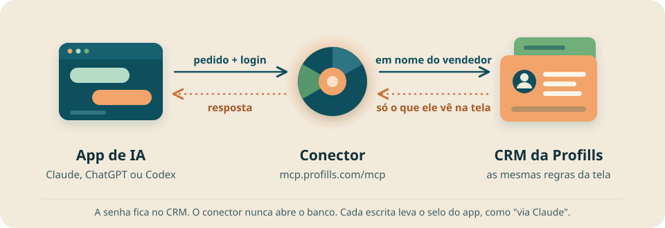

# CRM Profills MCP


O conector liga o seu app de IA ao CRM da Profills. O agente busca clientes, lê propostas, agenda e o Desempenho, e registra atendimentos, compromissos e contatos em seu nome, com as mesmas permissões da sua tela. Ele também manda propostas para aprovação e marca propostas como enviadas. O conector só serve a quem tem conta ativa no CRM.

Este repositório também é o plugin `crm-profills` do Claude Code e do Codex. O plugin traz o servidor do CRM e a skill `crm-profills-conexao`, que confere a conexão, refaz o login e acha servidor duplicado.

**Agente: comece por [docs/agentes.md](docs/agentes.md).**

## Como o pedido chega ao CRM



## Instalar

Endereço: `https://mcp.profills.com/mcp`. Em todos os apps, você faz o login no CRM com a sua conta e clica em permitir. A senha nunca passa pelo agente. O CRM aceita o login do Claude e do ChatGPT, e outro app recebe uma página do CRM com "Não foi possível conectar".

<details open>
<summary><strong>Claude</strong></summary>

Já tem o conector no claude.ai? Ele também aparece no Claude Code, e você não instala mais nada.

No terminal (Claude Code), sem o conector:

```bash
claude plugin marketplace add profillsbrasil/profills-skills
claude plugin install crm-profills@profills-skills
```

Depois digite `/mcp` e faça o login.

No app (claude.ai ou Claude Desktop): **Customize**, **Connectors** e **Add custom connector** com o endereço.

<details>
<summary>Passo a passo: plugin no Claude Code</summary>

1. Rode `claude mcp list`. Se o CRM já aparece, com qualquer nome e a URL `https://mcp.profills.com/mcp`, não instale de novo. Com `! Needs authentication`, falta só o login. Pule para o passo 4.
2. Adicione o marketplace da Profills:

   ```bash
   claude plugin marketplace add profillsbrasil/profills-skills
   ```

3. Instale o plugin para todos os projetos:

   ```bash
   claude plugin install crm-profills@profills-skills
   ```

   O servidor aparece como `plugin:crm-profills:crm-profills` no `claude mcp list`, com `! Needs authentication`.

4. Faça o login. Dentro do Claude Code, digite `/mcp`, escolha `plugin:crm-profills:crm-profills` e siga o navegador. No terminal, o comando é `claude mcp login plugin:crm-profills:crm-profills`. A tela de consentimento mostra um aviso extra: "O app roda no seu computador (...). Só permita se foi você quem abriu esta conexão agora." Se foi você, clique em permitir.

   Sem navegador na máquina, como numa sessão SSH, rode `claude mcp login --no-browser plugin:crm-profills:crm-profills` num terminal interativo (`ssh -t`). Abra a URL impressa no seu computador, faça o login e cole no terminal a URL inteira da barra de endereço.

5. Confira com `claude mcp list`. O servidor aparece com `✔ Connected`. Se uma sessão aberta antes não mostrar os tools do CRM, abra uma sessão nova.

O Claude Code renova o login sozinho. Para entrar de novo, use **Re-authenticate** no `/mcp` ou `claude mcp login plugin:crm-profills:crm-profills`. Para desconectar, use **Clear authentication** ou `claude mcp logout plugin:crm-profills:crm-profills`. O modo `claude -p` não faz o login, então faça o login antes numa sessão interativa.

</details>

<details>
<summary>Passo a passo: claude.ai e Claude Desktop</summary>

O conector adicionado na conta aparece no claude.ai, no Claude Desktop e no Claude Code. No plano Free, a conta tem no máximo 1 conector personalizado. No Pro e no Max, você mesmo adiciona. Os menus ficam em inglês.

1. Abra **Customize** e depois **Connectors**.
2. Clique em **+ Add** e depois em **Add custom connector**.
3. Dê um nome, como `CRM Profills`, preencha a URL `https://mcp.profills.com/mcp` e clique em **Continue**.
4. O Claude mostra a autenticação que detectou no servidor. Não mude nada e clique em **Continue**.
5. Em **Authentication**, escolha **Sign in now** ou **Sign in when needed**. Não escolha **No sign in**, porque sem login o servidor recusa toda chamada.
6. Em **OAuth client**, escolha **Use Claude's published identity (Recommended)**. As outras duas opções não funcionam.
7. Deixe **Request headers** vazio e clique em **Add**.
8. Entre com a sua conta do CRM e clique em permitir. Se o navegador não abrir sozinho, clique em **Connect** no conector, na lista de **Connectors**. Se o botão não aparecer, remova o conector e adicione de novo.

No Team, só o Owner e o Primary Owner adicionam o conector, em **Organization settings**, **Connectors**, **Add**, **Custom** e **Web**. No Enterprise, também adiciona quem tem o papel com "Manage access to Libraries". Quem adiciona escolhe as opções dos passos 5 a 7. Depois, cada membro abre **Customize** e **Connectors**, acha o conector com o rótulo **Custom** e clica em **Connect**.

</details>

</details>

<details>
<summary><strong>ChatGPT</strong></summary>

No terminal (Codex):

```bash
codex plugin marketplace add profillsbrasil/profills-skills
codex plugin add crm-profills@profills-skills
codex mcp login crm-profills
```

No app: **Developer mode** e **Create app** com o endereço.

<details>
<summary>Passo a passo: plugin no Codex</summary>

1. Rode `codex mcp list`. Se o CRM já aparece, com qualquer nome e a URL `https://mcp.profills.com/mcp`, não instale de novo. Com `Not logged in`, falta só o login. Pule para o passo 4.
2. Adicione o marketplace da Profills:

   ```bash
   codex plugin marketplace add profillsbrasil/profills-skills
   ```

3. Instale o plugin:

   ```bash
   codex plugin add crm-profills@profills-skills
   ```

   O servidor aparece como `crm-profills` no `codex mcp list`, com `Not logged in`.

4. Faça o login com `codex mcp login crm-profills`. Entre com a sua conta do CRM e clique em permitir. A tela de consentimento pode mostrar o aviso de app que roda no seu computador, como no Claude Code.

   Sem navegador na máquina, use `codex mcp login --no-browser crm-profills`, abra a URL impressa no seu computador, faça o login e cole no terminal a URL inteira da barra de endereço, que começa com `http://127.0.0.1`.

5. Confira com `codex mcp list`. O servidor aparece sem `Not logged in`.

Para entrar de novo, rode `codex mcp login crm-profills`. Para desconectar, rode `codex mcp logout crm-profills`.

</details>

<details>
<summary>Passo a passo: app do ChatGPT</summary>

1. Abra **Settings**, **Apps**, **Advanced settings** e ligue **Developer mode**.
2. Clique em **Create app**, ao lado de **Advanced settings**. Preencha a URL `https://mcp.profills.com/mcp` e escolha autenticação OAuth.
3. O app novo aparece em **Drafts**. Conecte, entre com a sua conta do CRM e clique em permitir.

O developer mode existe na web, nos planos Pro, Plus, Business, Enterprise e Education. No Business e no Enterprise, o admin liga o developer mode no painel de administração. Se o login falhar, avise o administrador do CRM e conte em que passo parou.

</details>

</details>

Teste pedindo "Mostre a minha agenda desta semana". A conexão funciona quando a resposta traz compromissos ou diz que a agenda está vazia.

## O que a tela de consentimento mostra

A tela tem o título "Conectar" seguido do nome do app, e o texto "quer acessar o CRM em seu nome.". Ela lista o app, o endereço para onde o login volta e a sua conta. O bloco "O que o acesso permite" diz duas coisas:

- "Ler clientes, propostas, agenda e Desempenho que você já vê no CRM."
- "Registrar, editar e excluir os seus atendimentos e compromissos, com as regras da tela."

Com o mesmo acesso, o agente também cria e edita contatos e manda propostas para aprovação ou marca a proposta como enviada. Uma conta inativa ou em análise recebe uma página de erro no lugar da tela de consentimento.

## Quanto tempo o login dura

O servidor de login é o próprio CRM. O app abre a página de login do CRM, você entra e permite, e o CRM entrega ao app um acesso em seu nome. O conector confere esse acesso em cada pedido e nunca vê a sua senha.

| Item | Duração |
|---|---|
| Acesso | 1 hora, renovado sozinho pelo app |
| Renovação do acesso, contada do último uso | 30 dias |
| Conexão inteira, contada do primeiro login | 90 dias |
| Pedido de consentimento aberto | 10 minutos |

Depois de 90 dias, ou se a conexão cair antes disso, faça o login de novo.

## Documentação

- [Guia para agentes](docs/agentes.md): o que o agente faz em ordem, regras de segurança, o ciclo da proposta, erros, exemplos e perguntas frequentes.
- [Tools e prompts](docs/tools.md): os 18 tools e os 2 prompts com a descrição e os parâmetros, gerados pelo código do servidor.
- [Skill de conexão](skills/crm-profills-conexao/SKILL.md): como o agente confere a conexão, refaz o login e tira servidor duplicado.
