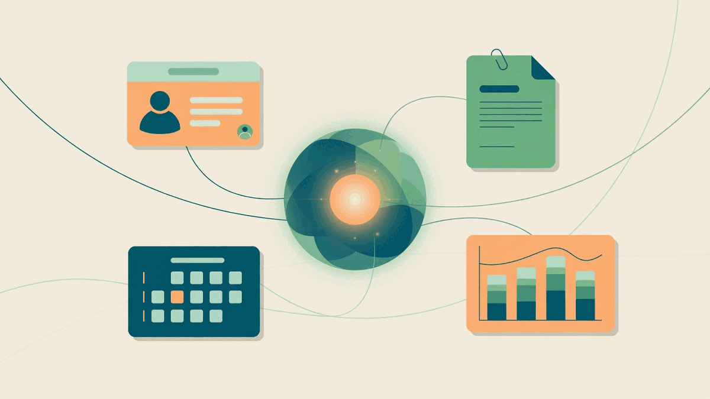
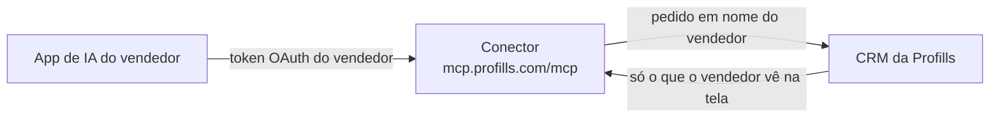

# CRM Profills MCP

Este conector MCP liga o app de IA do vendedor ao CRM da Profills. MCP é o protocolo que o Claude, o Codex e outros apps usam para chamar serviços de fora. O conector só serve a quem tem conta ativa no CRM da Profills.

Com ele, o agente busca clientes, lê propostas, agenda e o placar de Desempenho, registra atendimentos, compromissos e contatos, manda propostas para aprovação e marca propostas como enviadas. Tudo acontece em nome do vendedor que fez login, com as mesmas permissões que ele tem na tela do CRM.

**Agente: comece por [docs/guia-para-agentes.md](docs/guia-para-agentes.md).**

## Como o pedido chega ao CRM

O conector nunca abre o banco do CRM. Cada tool repassa o pedido ao CRM, que aplica as mesmas regras de ver e de editar da tela.

Cada escrita grava no histórico do cliente com a origem `agente` e um selo com o app, como "via Claude" ou "via Claude Code".

## Instalar

O endereço do conector é `https://mcp.profills.com/mcp`. O vendedor faz o login no CRM e clica em permitir. A senha nunca passa pelo agente.

| App | Situação | Como conectar |
|---|---|---|
| Claude (claude.ai e Claude Desktop) | Funciona | **Customize**, **Connectors** e **Add custom connector** com a URL acima. [Passo a passo](docs/instalacao.md#claudeai-e-claude-desktop) |
| Claude Code | Funciona | `claude mcp add --transport http --scope user crm-profills https://mcp.profills.com/mcp` e depois `/mcp`. [Passo a passo](docs/instalacao.md#claude-code) |
| Codex | Provável, ainda não testado. Só conecta depois que o CRM puser o Codex na lista de apps aceitos | `codex mcp add crm-profills --url https://mcp.profills.com/mcp`, que já abre o login. [Passo a passo](docs/instalacao.md#codex) |
| ChatGPT | Provável, ainda não testado | Developer mode e **Create app** com a URL acima. [Passo a passo](docs/instalacao.md#chatgpt-não-testado) |
| Cursor | Não funciona hoje | O Cursor não está na lista de apps aceitos do CRM. [Detalhes](docs/instalacao.md#cursor-não-funciona-hoje) |

Para testar, peça ao agente "Mostre a minha agenda desta semana". A conexão funciona quando a resposta traz compromissos ou diz que a agenda está vazia.

## Documentação

- [Instalação](docs/instalacao.md): o passo a passo por app, o login e o que não funciona.
- [Guia para agentes](docs/guia-para-agentes.md): o que o agente faz em ordem, regras de segurança, paginação, datas e erros.
- [Tools](docs/tools.md): os 18 tools, os parâmetros, o ciclo da proposta e os prompts.
- [Exemplos](docs/exemplos.md): pedidos do vendedor com a sequência de tools e as perguntas frequentes.
