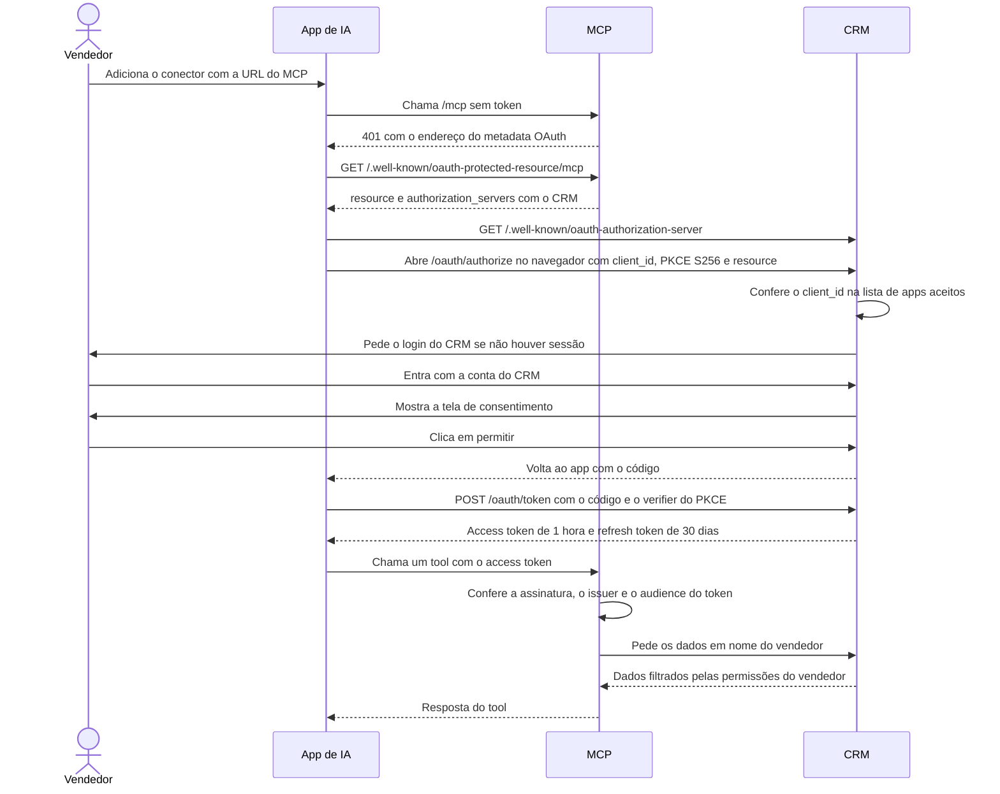

# Instalação

Esta página é para o vendedor ou o gestor que quer usar o CRM da Profills pelo app de IA. O conector só serve a quem tem conta ativa no CRM da Profills. O endereço do conector é `https://mcp.profills.com/mcp`.

Para conectar, vá direto à seção do seu app. A tabela de situação e os comandos `curl` servem para conferir o servidor e são opcionais.

- [Situação por app](#situação-por-app)
- [Confira se o servidor responde](#confira-se-o-servidor-responde)
- [Claude.ai e Claude Desktop](#claudeai-e-claude-desktop)
- [Claude Code](#claude-code)
- [Codex](#codex)
- [ChatGPT (não testado)](#chatgpt-não-testado)
- [Cursor (não funciona hoje)](#cursor-não-funciona-hoje)
- [Outros apps](#outros-apps)
- [O que a tela de consentimento mostra](#o-que-a-tela-de-consentimento-mostra)
- [Como o login funciona](#como-o-login-funciona)

## Situação por app

O CRM só aceita o login dos apps de uma lista fixa. Cada app se identifica por um endereço público de metadados (CIMD). O Cursor não tem esse endereço e fica fora da lista.

| App | Endereço CIMD | Situação |
|---|---|---|
| Claude (claude.ai e Claude Desktop) | `https://claude.ai/oauth/mcp-oauth-client-metadata` | Funciona |
| Claude Code | `https://claude.ai/oauth/claude-code-client-metadata` | Funciona |
| Codex | `https://chatgpt.com/oauth/codex/client.json` | Funciona (login testado em 13/10/2026) |
| ChatGPT | `https://chatgpt.com/oauth/client.json` | Provável, ainda não testado |
| Cursor | nenhum | Não funciona hoje |

Na coluna "Situação", "Funciona" quer dizer que o app está na lista e alguém já conectou. "Provável" quer dizer que o app está na lista, mas ninguém conectou ainda. "Não funciona" quer dizer que o app não está na lista, e o CRM recusa o login.

Em todos os apps, duas etapas são só do vendedor. Ele entra no CRM com a própria conta e clica em permitir na tela de consentimento. A senha nunca passa pelo agente.

## Confira se o servidor responde

Este passo é opcional para o vendedor. O agente usa estes comandos antes de configurar o conector. Os dois respondem sem login.

```bash
curl -s https://mcp.profills.com/.well-known/oauth-protected-resource/mcp
```

Você vê um JSON com `"resource": "https://mcp.profills.com/mcp"`, `"resource_name": "CRM Profills"` e `authorization_servers` com o endereço do CRM.

```bash
curl -s https://www.crmprofills.com.br/.well-known/oauth-authorization-server
```

Você vê um JSON com `"client_id_metadata_document_supported": true` e sem `registration_endpoint`.

## Claude.ai e Claude Desktop

O conector personalizado existe nos planos Free, Pro, Max, Team e Enterprise. No plano Free, a conta tem no máximo 1 conector personalizado. O conector adicionado na conta aparece também no Claude Desktop. O arquivo `claude_desktop_config.json` serve para servidores locais e não entra aqui.

No Pro e no Max, o próprio vendedor adiciona o conector. Os nomes dos menus abaixo vêm da [página de suporte do Claude sobre conectores personalizados](https://support.claude.com/en/articles/11175166-getting-started-with-custom-connectors-using-remote-mcp), conferida em 09/10/2026. A tela fica em inglês.

1. Abra **Customize** e depois **Connectors**.
2. Clique em **+ Add** e depois em **Add custom connector**.
3. Dê um nome, como `CRM Profills`, preencha a URL `https://mcp.profills.com/mcp` e clique em **Continue**.
4. O Claude mostra a autenticação que detectou no servidor. Não mude nada e clique em **Continue**.
5. Em **Authentication**, escolha **Sign in now** ou **Sign in when needed**. Não escolha **No sign in**. Sem login, o servidor recusa toda chamada, e a opção **OAuth client** do passo 6 some da tela.
6. Em **OAuth client**, escolha **Use Claude's published identity (Recommended)**. As outras duas opções não funcionam, porque o CRM não aceita registro automático nem client próprio.
7. Deixe **Request headers** vazio. O login já identifica o vendedor.
8. Clique em **Add**.
9. Faça o login no CRM. Se o navegador não abrir sozinho, clique em **Connect** no conector, na lista de **Connectors**. A página de suporte só descreve o **Connect** no Team e no Enterprise, então esse botão no Pro e no Max não está confirmado. Se ele não aparecer, remova o conector e adicione de novo.
10. Entre com a sua conta do CRM e clique em permitir na tela de consentimento.

O Claude volta para a conversa com o conector ligado. Para testar, peça "Mostre a minha agenda desta semana". O conector está pronto quando a resposta traz compromissos ou diz que a agenda está vazia.

No Team, só o Owner e o Primary Owner adicionam o conector, em **Organization settings**, **Connectors**, **Add**, **Custom** e **Web**. No Enterprise, também adiciona quem tem o papel com "Manage access to Libraries". Quem adiciona escolhe as opções dos passos 5 a 7. Depois disso, cada membro abre **Customize** e **Connectors**, acha o conector com o rótulo **Custom** e clica em **Connect**.

## Claude Code

Os comandos abaixo foram conferidos na [documentação de MCP do Claude Code](https://code.claude.com/docs/en/mcp) em 09/10/2026 e no `claude mcp --help` da versão 2.1.296.

1. Veja se o servidor já está configurado:

   ```bash
   claude mcp list
   ```

   Se `crm-profills` aparece com `✔ Connected`, o conector já funciona. Pule para o passo 6. Se aparece com a URL `https://mcp.profills.com/mcp` e `! Needs authentication`, falta só o login. Pule para o passo 3, porque um segundo `add` falha com "already exists". Se aparece com outra URL, remova antes com `claude mcp remove crm-profills`. O `remove` também apaga o login guardado desse servidor.

2. Adicione o servidor para todos os projetos:

   ```bash
   claude mcp add --transport http --scope user crm-profills https://mcp.profills.com/mcp
   ```

   O nome `crm-profills` é uma escolha desta documentação. O escopo `user` grava o servidor em `~/.claude.json` e deixa o CRM disponível em qualquer pasta. Para usar só no projeto atual, troque por `--scope local`, o padrão. O escopo `project` grava `.mcp.json` na raiz do projeto e pede aprovação na sessão antes de conectar.

   Depois do `add`, `claude mcp list` mostra o servidor como `! Needs authentication`. O login ainda não aconteceu.

3. Faça o login. Dentro do Claude Code, digite `/mcp`, escolha `crm-profills` e siga o navegador. No terminal, o comando equivalente é este:

   ```bash
   claude mcp login crm-profills
   ```

   Sem navegador na máquina, como numa sessão SSH, o comando imprime a URL de login. Abra a URL no seu computador. Depois do login, copie a URL inteira da barra de endereço do navegador e cole no terminal. Esse passo pede um terminal interativo, então conecte com `ssh -t`. Para forçar esse modo, use `claude mcp login --no-browser crm-profills`.

4. Entre com a sua conta do CRM. A tela de consentimento mostra um aviso extra: "O app roda no seu computador (...). Só permita se foi você quem abriu esta conexão agora." O aviso aparece porque o Claude Code recebe o login num endereço local. Se foi você quem abriu, clique em permitir.

5. Confira com `claude mcp list`. O servidor aparece com `✔ Connected`.

6. Abra o Claude Code e peça "Mostre a minha agenda desta semana". O agente chama `minha_agenda` e lista os compromissos. Se uma sessão que já estava aberta não mostrar os tools do CRM, abra uma sessão nova.

O Claude Code guarda e renova o login sozinho. Para entrar de novo, abra `/mcp`, escolha `crm-profills` e use **Re-authenticate**, ou rode `claude mcp login crm-profills`. Para desconectar, abra `/mcp` e use **Clear authentication**, ou rode `claude mcp logout crm-profills`.

No modo não interativo (`claude -p`), o Claude Code não faz o login. Faça o login antes numa sessão interativa.

## Codex

O login do Codex foi testado em 13/10/2026 e funcionou. Uma chamada de tool pelo Codex ainda não foi conferida. Se o login parar numa página do CRM com "Não foi possível conectar", o CRM não aceitou o app. Os comandos abaixo foram conferidos no `codex mcp --help` da versão 0.162.1.

1. Veja se o servidor já está configurado:

   ```bash
   codex mcp list
   ```

   Se `crm-profills` aparece com a URL `https://mcp.profills.com/mcp` e sem `Not logged in`, o conector já funciona. Pule para o passo 5. Se aparece com `Not logged in`, pule para o passo 3. Se aparece com outra URL, remova antes com `codex mcp remove crm-profills`.

2. Adicione o servidor:

   ```bash
   codex mcp add crm-profills --url https://mcp.profills.com/mcp
   ```

   O `add` grava o servidor em `~/.codex/config.toml`, imprime a URL de login e já abre o login no navegador. O comando fica parado até o login terminar. Rode o `add` num terminal interativo. No fim, o terminal mostra `Successfully logged in.`. Se o login terminar aqui, pule para o passo 4.

   Sem navegador na máquina, como numa sessão SSH, o `add` fica parado sem mostrar nada. Interrompa com Ctrl+C. O servidor já ficou gravado, e o login segue no passo 3.

3. Faça o login, se o `add` não fez:

   ```bash
   codex mcp login crm-profills
   ```

   Sem navegador na máquina, use `codex mcp login --no-browser crm-profills`. O comando imprime a URL de login. Abra a URL no seu computador e faça o login. O navegador volta para um endereço `http://127.0.0.1:<porta>/callback`, que não abre no seu computador. Copie a URL inteira da barra de endereço e cole no terminal. Esse passo também pede um terminal interativo.

4. Entre com a sua conta do CRM e clique em permitir na tela de consentimento. O Codex recebe o login num endereço local, como o Claude Code, então a tela deve mostrar o mesmo aviso: "O app roda no seu computador (...)". Esse aviso não foi conferido com o Codex. Se foi você quem abriu a conexão, clique em permitir.

5. Confira com `codex mcp list`. O servidor aparece sem `Not logged in`. Abra o Codex e peça "Mostre a minha agenda desta semana". O agente chama `minha_agenda` e lista os compromissos.

Para fazer o login de novo, rode `codex mcp login crm-profills`. Para desconectar, rode `codex mcp logout crm-profills`. As escritas feitas pelo Codex aparecem no CRM com o selo "via Codex".

## ChatGPT (não testado)

Ninguém conectou o ChatGPT ainda. Os passos abaixo vêm de um resumo da documentação da OpenAI e não estão confirmados.

1. Abra **Settings**, **Apps**, **Advanced settings** e ligue **Developer mode**.
2. Clique em **Create app**, ao lado de **Advanced settings**. Preencha a URL `https://mcp.profills.com/mcp` e escolha autenticação OAuth.
3. O app novo aparece em **Drafts**. Conecte, entre com a conta do CRM e clique em permitir.

O developer mode existe nos planos Pro, Plus, Business, Enterprise e Education, na web. No Business e no Enterprise, o admin liga o developer mode no painel de administração. Guias de terceiros dizem que a escrita pelo app só funciona no Business, no Enterprise e no Education. Isso não está confirmado. No Plus ou no Pro, o agente pode ler e não conseguir gravar.

Se o login falhar, avise o administrador do CRM e conte em que passo parou.

## Cursor (não funciona hoje)

O Cursor não está na lista de apps aceitos do CRM, e o CRM recusa o login dele.

## Outros apps

O CRM recusa o login de qualquer app fora da lista de [Situação por app](#situação-por-app). O MCP Inspector e outros clientes MCP que dependem de registro automático caem nesse caso.

## O que a tela de consentimento mostra

A tela tem o título "Conectar" seguido do nome do app. Logo abaixo vem o texto "quer acessar o CRM em seu nome.", também com o nome do app na frente. A tela lista o app (nome e endereço), o endereço para onde o login volta e a sua conta. O bloco "O que o acesso permite" diz duas coisas:

- "Ler clientes, propostas, agenda e Desempenho que você já vê no CRM."
- "Registrar, editar e excluir os seus atendimentos e compromissos, com as regras da tela."

O bloco não cita tudo o que o agente faz. Com o mesmo acesso, o agente também cria e edita contatos e manda propostas para aprovação ou marca a proposta como enviada.

Uma conta inativa ou em análise recebe uma página de erro no lugar da tela de consentimento.

## Como o login funciona

O servidor de login é o próprio CRM. O MCP só confere o token que o CRM emitiu. O app se identifica pelo endereço CIMD, e o CRM só aceita os endereços da lista.



Prazos do login:

| Item | Duração |
|---|---|
| Access token | 1 hora |
| Código de autorização | 5 minutos |
| Pedido de consentimento | 10 minutos |
| Refresh token, renovado a cada uso | 30 dias |
| Conexão inteira, contada a partir do primeiro login | 90 dias |

O app renova o acesso sozinho. Depois de 90 dias, o vendedor conecta de novo. Se a conexão cair antes disso, o vendedor também conecta de novo.
