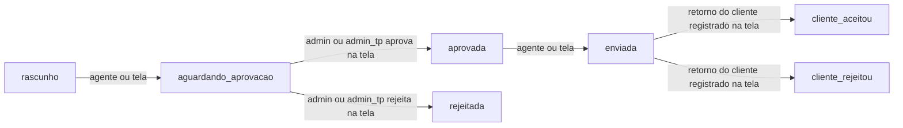

# Tools

Esta página é a referência dos 18 tools e dos 2 prompts do servidor. Para saber qual tool chamar a partir do pedido do vendedor, veja [Qual tool chamar](guia-para-agentes.md#qual-tool-chamar).

- [Tipos de tool](#tipos-de-tool)
- [Tools por área](#tools-por-área)
- [Parâmetros de cada tool](#parâmetros-de-cada-tool)
- [Ciclo da proposta](#ciclo-da-proposta)
- [Prompts](#prompts)

## Tipos de tool

São 18 tools: 9 de leitura, 3 que criam registro e 6 que alteram. O tipo vem nas anotações de cada tool:

- `leitura` só lê. Repetir não muda nada.
- `criar` grava um registro novo. Repetir grava outro.
- `alterar` edita, exclui ou envia. O tool traz a anotação `destructive_hint`. Repetir o mesmo pedido não muda mais nada no CRM, mas a resposta muda. Uma edição repetida com os mesmos valores devolve o registro igual. Uma exclusão repetida volta "não encontrado", porque o registro já saiu. Um envio repetido volta "Nada foi gravado por este pedido: a proposta já está em ...".

## Tools por área

### Clientes

| Tool | Tipo | Para que serve |
|---|---|---|
| `buscar_clientes` | leitura | Busca clientes por nome, razão social, CPF/CNPJ, telefone ou e-mail. Traz `cidade`, `uf`, `bateu_em` e os contatos |
| `ver_cliente` | leitura | Ficha do cliente: cadastro, dono, secundários, contatos com observações, 10 últimos atendimentos, propostas ativas, próximos compromissos do vendedor e link da tela |
| `minha_carteira` | leitura | Clientes de que o vendedor é dono ou secundário, de quem está há mais tempo sem atendimento para o atendido por último |

### Contatos

| Tool | Tipo | Para que serve |
|---|---|---|
| `criar_contato` | criar | Cadastra um contato num cliente. O vendedor conectado fica como responsável |
| `editar_contato` | alterar | Altera só os campos informados de um contato |

### Atendimentos

| Tool | Tipo | Para que serve |
|---|---|---|
| `listar_atendimentos` | leitura | Atendimentos de um cliente além dos 10 da ficha, com a descrição inteira |
| `meus_atendimentos` | leitura | Atendimentos de que o vendedor é autor. Sem `status`, traz os Pendente e os Em Andamento |
| `registrar_atendimento` | criar | Registra um atendimento com a data de agora |
| `editar_atendimento` | alterar | Altera assunto, status, descrição ou contato. A data e o autor não mudam |
| `excluir_atendimento` | alterar | Exclui o atendimento. Não se desfaz |

### Agenda

| Tool | Tipo | Para que serve |
|---|---|---|
| `minha_agenda` | leitura | Compromissos do próprio vendedor num período de até 62 dias |
| `criar_compromisso` | criar | Cria um compromisso na agenda do próprio vendedor. Sem `fim`, dura 1 hora |
| `editar_compromisso` | alterar | Altera um compromisso. Mudar só o `inicio` desloca o fim e mantém a duração |
| `excluir_compromisso` | alterar | Exclui o compromisso. Não se desfaz |

### Propostas

| Tool | Tipo | Para que serve |
|---|---|---|
| `ver_proposta` | leitura | Detalhe pelo `proposta_id` ou pelo `codigo`: estágio, versão, itens, forma escolhida, versões, follow-ups e link |
| `listar_propostas` | leitura | Propostas ativas por escopo, estágio, dia de envio ou proposta parada |
| `enviar_proposta` | alterar | Faz o que os dois botões de envio da tela fazem. O CRM não manda nada ao cliente |

### Desempenho

| Tool | Tipo | Para que serve |
|---|---|---|
| `ver_desempenho` | leitura | Placar do relatório de Desempenho na semana ou no mês, com as mesmas regras da tela. Só para quem tem acesso ao relatório |

## Parâmetros de cada tool

Parâmetro sem "sim" na coluna "Obrigatório" é opcional. Todo id é um número inteiro lido de uma resposta deste servidor. Os formatos de data e de código de proposta estão em [Datas](guia-para-agentes.md#datas) e [Código de proposta](guia-para-agentes.md#código-de-proposta). A paginação está em [Paginação](guia-para-agentes.md#paginação).

### `buscar_clientes`

| Parâmetro | Obrigatório | Valores |
|---|---|---|
| `q` | sim | 1 a 200 caracteres. Com `@`, busca e-mail. Só números e pontuação, busca CPF/CNPJ e, com 8 dígitos ou mais, telefone. Outro texto busca razão social, nome fantasia e nome de contato |
| `limite` | | 1 a 50, padrão 20 |

No texto, cada palavra precisa bater em algum campo, em qualquer ordem. A busca ignora conectivos (de, da, do, e) e sufixos de empresa (Ltda, ME, EIRELI, EPP, S/A) e usa só as 6 primeiras palavras. Até 3 clientes na resposta, `contatos` traz todos os contatos de cada um. Com mais de 3, só os contatos em que a busca bateu.

### `ver_cliente`

| Parâmetro | Obrigatório | Valores |
|---|---|---|
| `cliente_id` | sim | O `id` de `buscar_clientes` ou de outra resposta |

Com `mais_atendimentos: true`, o resto dos atendimentos vem por `listar_atendimentos` com `antes` igual ao `id` do último atendimento da ficha. Com `mais_compromissos: true`, o resto vem por `minha_agenda`, filtrando os itens com `cliente.id` igual a este cliente. As propostas da ficha trazem só `valor_total`.

### `ver_proposta`

| Parâmetro | Obrigatório | Valores |
|---|---|---|
| `codigo` | um dos dois | O código que o vendedor fala, como `0072/26` ou `72` |
| `proposta_id` | um dos dois | O `id` interno, vindo de outra resposta do servidor |

Pelo código vem a versão ativa, ou a última quando nenhuma está ativa. O `id`, a `versao` e a `ativa` do topo da resposta dizem qual veio. `versoes` lista as outras versões do mesmo código, cada uma com `id`, `versao`, `estagio` e `ativa`. Abra outra versão pelo `id` dela.

Para o valor fechado de uma proposta aceita:

1. Confira o `estagio`. Só em `cliente_aceitou` existe valor fechado. Em outro estágio, diga ao vendedor o estágio real e não dê valor fechado.
2. Leia `forma_escolhida.valor_final`. Nunca use `valor_total`, que é o valor da proposta antes do fechamento.
3. Repasse o valor como veio, uma string como `"1000.00"`. Se `forma_escolhida` não vier, diga ao vendedor que o CRM não tem o valor fechado dessa proposta.

### `listar_propostas`

| Parâmetro | Obrigatório | Valores |
|---|---|---|
| `escopo` | | `visiveis` (padrão), `minhas`, `aguardando_minha_aprovacao` ou `cliente` |
| `cliente_id` | com `escopo` igual a `cliente` | Id do cliente |
| `vendedor_id` | | Id do vendedor responsável. Só admin e admin_tp |
| `estagio` | | `rascunho`, `aguardando_aprovacao`, `aprovada`, `enviada`, `rejeitada`, `cliente_aceitou` ou `cliente_rejeitou` |
| `enviada_desde`, `enviada_ate` | | Dias de envio, os dois inclusive |
| `atualizado_antes_de` | | Propostas paradas desde antes deste dia |
| `limite`, `antes` | | Paginação |

Cada item traz `prazo_retorno`, o dia em que vencem os 30 dias do envio. Ele só é prazo pendente quando o `estagio` é `enviada`. `valor_final` só vem em `cliente_aceitou`.

### `minha_carteira`

| Parâmetro | Obrigatório | Valores |
|---|---|---|
| `sem_atendimento_ha_dias` | | 1 a 3650. Inclui quem nunca teve atendimento |
| `cidade` | | Até 45 caracteres, sem diferença de maiúscula nem acento |
| `uf` | | 2 letras, como `PR` |
| `cursor`, `limite` | | Paginação por `proximo_cursor` |

Com `ultimo_atendimento_aproximado: true`, a data é anterior a 03/07/2026 e o CRM só garante que o atendimento foi nesse dia ou antes. Diga ao vendedor "em tal dia ou antes".

A carteira mede atendimento, não visita. `ultimo_atendimento_em` é o último atendimento registrado no cliente, de qualquer autor. Um compromisso de visita na agenda não conta. Quando o vendedor pergunta por "visita", diga que a lista é de clientes sem atendimento registrado.

### `listar_atendimentos`

| Parâmetro | Obrigatório | Valores |
|---|---|---|
| `cliente_id` | sim | Id do cliente |
| `antes`, `limite` | | Paginação. `limite` vai de 1 a 50, padrão 20 |

Cada item traz `assunto`, `status`, `data`, `autor` e a `descricao` inteira, do registrado por último para o mais antigo.

### `meus_atendimentos`

| Parâmetro | Obrigatório | Valores |
|---|---|---|
| `status` | | `Em Andamento`, `Concluído`, `Pendente` ou `Cancelado`. Sem ele, vêm os Pendente e os Em Andamento |
| `desde` | | Só os atendimentos deste dia em diante |
| `antes`, `limite` | | Paginação |

Só vêm os atendimentos de que o vendedor é autor, sem a descrição. A descrição vem por `ver_cliente` ou `listar_atendimentos`.

### `registrar_atendimento`

| Parâmetro | Obrigatório | Valores |
|---|---|---|
| `cliente_id` | sim | Id do cliente |
| `assunto` | sim | 1 a 255 caracteres |
| `status` | sim | `Em Andamento`, `Concluído`, `Pendente` ou `Cancelado` |
| `descricao` | | Até 5.000 caracteres |
| `contato_id` | | Id de um contato do cliente, da lista `contatos` de `ver_cliente` |

A data do atendimento é a hora do registro e não muda depois. Veja como escolher o cliente, o contato e o `status` em [Antes de gravar](guia-para-agentes.md#antes-de-gravar).

### `editar_atendimento`

| Parâmetro | Obrigatório | Valores |
|---|---|---|
| `atendimento_id` | sim | De `ver_cliente`, `listar_atendimentos` ou `meus_atendimentos` |
| `assunto`, `status`, `descricao`, `contato_id` | ao menos um | Os mesmos valores de `registrar_atendimento`. `descricao` igual a `""` apaga a descrição |

Só os campos informados mudam. A data e o autor nunca mudam, e a edição não tira o contato.

### `excluir_atendimento`

| Parâmetro | Obrigatório | Valores |
|---|---|---|
| `atendimento_id` | sim | Id do atendimento |

Confirme com o vendedor antes. A resposta traz o atendimento excluído, com `excluido: true`.

### `minha_agenda`

| Parâmetro | Obrigatório | Valores |
|---|---|---|
| `de` | | Primeiro dia. Padrão: hoje |
| `ate` | | Último dia, inclusive. Padrão: `de` mais 14 dias. No máximo 62 dias depois de `de` |

Para um dia só, mande `de` e `ate` com a mesma data. Vêm só os compromissos do próprio vendedor que tocam o período, com `id`, `titulo`, `descricao`, `inicio`, `fim`, `tipo` e `cliente`.

### `criar_compromisso`

| Parâmetro | Obrigatório | Valores |
|---|---|---|
| `titulo` | sim | 1 a 255 caracteres |
| `inicio` | sim | Data e hora |
| `fim` | | Data e hora depois do início. Sem `fim`, o compromisso dura 1 hora, e você avisa o vendedor |
| `cliente_id` | | Id do cliente |
| `tipo` | | `client`, `internal` ou `operational`. Padrão `client` com cliente, senão `internal` |
| `descricao` | | Até 5.000 caracteres |

### `editar_compromisso`

| Parâmetro | Obrigatório | Valores |
|---|---|---|
| `compromisso_id` | sim | De `minha_agenda` ou `ver_cliente` |
| `titulo`, `inicio`, `fim`, `descricao`, `cliente_id`, `tipo` | ao menos um | Os mesmos valores de `criar_compromisso` |

Com só `inicio`, o CRM desloca o fim junto e mantém a duração. Com só `fim`, ele precisa ficar depois do início gravado. Para mudar a duração, mande `inicio` e `fim`. Mudar `cliente_id` não muda o `tipo`, e a edição não tira o cliente.

### `excluir_compromisso`

| Parâmetro | Obrigatório | Valores |
|---|---|---|
| `compromisso_id` | sim | Id do compromisso |

Confirme com o vendedor antes. A resposta traz o compromisso excluído, com `excluido: true`.

### `criar_contato`

| Parâmetro | Obrigatório | Valores |
|---|---|---|
| `cliente_id` | sim | Id do cliente |
| `nome` | sim | 1 a 45 caracteres |
| `telefone` | sim | Número brasileiro com DDD, de 10 ou 11 dígitos, um só, sem ramal. O CRM grava como (11) 98765-4321 |
| `email` | | Até 255 caracteres, com `@` e sem espaço |
| `cargo`, `departamento` | | Até 45 caracteres cada |
| `observacoes` | | Até 5.000 caracteres |

O CRM não barra contato duplicado. Antes de criar, procure o telefone e o e-mail com `buscar_clientes` e leia os `contatos` de `ver_cliente`.

### `editar_contato`

| Parâmetro | Obrigatório | Valores |
|---|---|---|
| `contato_id` | sim | De `contatos` em `ver_cliente` ou em `buscar_clientes` |
| `nome`, `telefone`, `email`, `cargo`, `departamento`, `observacoes` | ao menos um | Os mesmos valores de `criar_contato`. `""` apaga `email`, `cargo`, `departamento` ou `observacoes`. `nome` e `telefone` não ficam vazios |

Mande só os campos que mudam. `observacoes` troca o texto inteiro. Leia o texto atual em `ver_cliente` e mande o texto final completo.

### `enviar_proposta`

| Parâmetro | Obrigatório | Valores |
|---|---|---|
| `proposta_id` | sim | O `id` do topo da resposta de `ver_proposta`, quando `ativa` é 1 |
| `destino` | sim | `aguardando_aprovacao` leva o rascunho para a fila de aprovação. `enviada` marca a proposta aprovada como enviada |

Cada destino vale para um estágio só:

| `destino` | Estágio que a proposta precisa ter | Estágio depois do envio |
|---|---|---|
| `aguardando_aprovacao` | `rascunho` | `aguardando_aprovacao` |
| `enviada` | `aprovada` | `enviada` |

Siga esta ordem:

1. Chame `ver_proposta` com o `codigo`.
2. Se `ativa` não é 1, avise o vendedor que a proposta não tem versão ativa e não envie.
3. Se o `estagio` não é o da tabela acima, diga ao vendedor o estágio atual e não envie.
4. Mostre ao vendedor o código, o cliente, o estágio atual e o destino, e espere o "sim" dele. "Manda a 72/26" é o pedido, não a confirmação.
5. Depois do "sim", chame `ver_proposta` de novo e use o `id` dessa leitura. Assim o envio usa a versão ativa de agora.
6. Chame `enviar_proposta` e diga ao vendedor qual proposta de qual cliente foi enviada.

### `ver_desempenho`

| Parâmetro | Obrigatório | Valores |
|---|---|---|
| `modo` | | `mes` (padrão) ou `semana` |
| `data` | | Qualquer dia do período. Padrão: hoje. Há dados desde a semana de 06/07/2026 e o mês de julho de 2026 |
| `escopo` | | `empresa` ou o nome de uma praça. Só vale um dos `escopos_disponiveis` do vendedor, que vêm na resposta. Padrão: `empresa` para quem vê todas as praças, senão a praça do vendedor |

Cada métrica de `metricas` traz `atual`, `anterior` e `variacao_pct`. `projecao` só vem no mês em curso. Repita ao vendedor os `avisos` da resposta.

## Ciclo da proposta

O agente move a proposta em dois pontos. O resto acontece na tela do CRM.

- `enviar_proposta` com `destino` igual a `aguardando_aprovacao` põe a proposta na fila de Aprovações dos Avisos. O CRM não manda e-mail nem notificação. O admin aprova ou rejeita pela tela, e o admin_tp faz o mesmo nos clientes do tier TP.
- `enviar_proposta` com `destino` igual a `enviada` só grava a data de envio. O vendedor manda o PDF ao cliente por fora. O PDF gerado com a proposta em `aprovada` sai com marca de rascunho. Depois do envio, o `link` da resposta abre a proposta na tela, e o PDF sai sem a marca.
- A data de envio começa um prazo de 30 dias. Se o prazo vence sem o retorno do cliente registrado na tela, o CRM bloqueia proposta nova do vendedor responsável para esse cliente.
- Podem enviar o responsável pela proposta, o admin, o admin_tp nos clientes do tier TP e o dono do cliente quando o responsável está inativo. Se o vendedor não puder enviar, o tool responde com o erro de permissão.

## Prompts

Os prompts são atalhos para pedidos de rotina. Cada um devolve um texto que diz ao agente quais tools chamar e repete as regras do servidor. Os dois só leem o CRM.

| Prompt | Argumento | O que pede ao agente |
|---|---|---|
| `minha_semana` | nenhum | Agenda de hoje até 6 dias depois, no horário de Brasília. Propostas `minhas` em `enviada`, todas as páginas de 50, com as vencendo (28 ou 29 dias do envio) e as vencidas (30 dias ou mais) marcadas. Placar da semana em `ver_desempenho`, deixado de fora sem nova tentativa se o vendedor não tem acesso |
| `resumo_do_cliente` | `cliente`, obrigatório: nome, telefone ou CNPJ, até 200 caracteres, numa linha | Busca com `buscar_clientes` e, com a lista vazia, tenta uma vez pela `dica`. Com mais de um cliente, pede ao vendedor para escolher. Resume a ficha de `ver_cliente`. Para propostas em `cliente_aceitou`, lê o valor em `forma_escolhida.valor_final` com `ver_proposta`. Termina com um próximo passo |

No Claude Code, os prompts aparecem no menu `/` como `/<servidor>:minha_semana (MCP)`. Digitar `/mcp__<servidor>__minha_semana` também roda. O Claude Code separa os argumentos por espaço, então `resumo_do_cliente` recebe uma palavra só. Para um nome com espaço, use o CNPJ, o telefone sem espaço ou uma palavra do nome.

Quem escolhe um prompt é o vendedor, no menu do app. No protocolo MCP, o prompt é disparado pelo usuário, e o agente não chama prompt como chama tool. Se você é o agente e o vendedor pede "resumo da minha semana", faça a mesma sequência da tabela acima com os tools.
